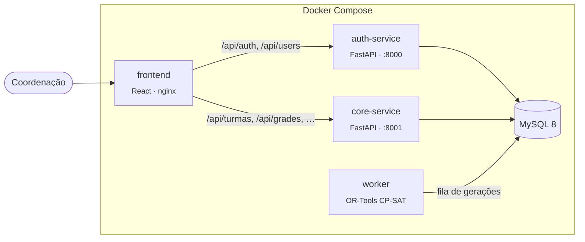

<div align="center">


# Grade Certa

**Monte a grade de horários da escola em minutos, sem choque de professor, sem janela e respeitando a disponibilidade de cada um.**

[](https://react.dev)
[](https://www.typescriptlang.org)
[](https://tailwindcss.com)
[](https://fastapi.tiangolo.com)
[](https://developers.google.com/optimization)
[](https://www.mysql.com)
[](https://docs.docker.com/compose/)

[Funcionalidades](#funcionalidades) ·
[Como o gerador decide](#como-o-gerador-decide) ·
[Arquitetura](#arquitetura) ·
[Começando](#começando) ·
[Desenvolvimento](#desenvolvimento) ·
[Produção](#produção)

</div>

---

## Sobre

Montar a grade de uma escola à mão leva dias. São dezenas de turmas, professores que dão aula
em várias delas, gente que só pode em alguns dias, laboratório que precisa cair numa tarde certa,
e cada mudança derruba outras três.

O **Grade Certa** é a ferramenta da coordenação para esse trabalho. Você cadastra turmas,
disciplinas, professores e salas, diz quando cada professor pode dar aula, e o gerador monta a
semana inteira. Ele usa um **solver de restrições (Google OR-Tools CP-SAT)**: tudo o que é
regra vale sempre, e o resto ele otimiza na ordem que a escola definiu. Depois dá para ajustar
aula por aula, vendo na hora o que cada mudança quebra.

## Funcionalidades

<table>
<tr>
<td width="50%" valign="top">

### Cadastros
- **Turmas** de Anos Iniciais, Anos Finais e Ensino Médio, com turno de manhã, tarde, integral
  ou *manhã + tardes*
- **Matriz curricular** por turma: aulas por semana, um ou mais professores, aula extra, dia ou
  horário fixo e disciplinas **só à tarde**
- **Disponibilidade** de cada professor num quadro semanal: *indisponível*, *evitar* ou livre
- **Salas** com tipo (laboratório, quadra…) e horários bloqueados
- **Jornada** da escola e por professor: almoço, máximo de aulas e de horas por dia

</td>
<td width="50%" valign="top">

### Geração
- **Checklist antes de gerar**: matrizes incompletas, carga acima do limite e aula fixada em
  horário indisponível aparecem antes de clicar em *Gerar*
- Geração em **segundo plano**, com tempo de busca configurável, progresso e **cancelamento**
- Quando não há solução, o gerador **diz qual regra** entra em conflito com os dados
- **Histórico** de gerações, com a grade ativa por semestre

</td>
</tr>
<tr>
<td valign="top">

### Revisão
- Grade **por turma, por professor e por sala**, com cores por área do conhecimento
- **Edição manual** com simulação: os conflitos aparecem enquanto você move a aula
- Tela de **conflitos** com sugestão de horário e correção em um clique
- **Resumo** da grade: janelas, planejamento compartilhado, carga por professor

</td>
<td valign="top">

### Para o dia a dia
- **Impressão** da grade de cada turma, professor e sala em A4
- Painel inicial com a **qualidade da grade** e as pendências
- **Usuários** da coordenação, com login por token e limite de tentativas
- **Tema claro e escuro**

</td>
</tr>
</table>

## Como o gerador decide

O gerador trata os pedidos da escola em dois níveis.

**Sempre respeitado.** Se uma regra não couber, a geração falha e aponta qual foi:

- aulas semanais de cada disciplina, conforme a matriz da turma
- nenhum professor, turma ou sala em dois lugares ao mesmo tempo
- disponibilidade dos professores e horários bloqueados das salas
- aulas dobradas, aulas fixadas em dia ou horário e disciplinas só à tarde
- quem dá a primeira aula do turno não dá a última no mesmo dia
- turmas sem horário vago no meio do turno
- almoço, limite de aulas e de horas por dia de cada professor
- 4 horários de planejamento por professor

**Otimizado, nesta ordem.** Cada nível pesa mais que todos os de baixo juntos:

| # | Objetivo |
|:-:|---|
| 1 | Menos **janelas** na agenda dos professores |
| 2 | Menos **tardes** usadas nas turmas de *manhã + tardes* |
| 3 | Tardes com aula fixa (laboratório, redação…) sem outras aulas regulares |
| 4 | Menos aulas nos horários que o professor pediu para **evitar** |
| 5 | **Planejamento compartilhado** com um colega da mesma área |

A busca roda em duas fases. A primeira encontra rápido uma grade válida, e a segunda usa o tempo
que sobra para melhorá-la.

## Arquitetura



| Serviço | O que faz |
|---|---|
| `frontend` | Interface em React 19 + Vite, servida pelo nginx, que também encaminha `/api` para os serviços |
| `auth-service` | Usuários e login (JWT) |
| `core-service` | Cadastros, matrizes, grades, conflitos e simulação de edição |
| `worker` | Roda as gerações da fila, separado da API: reiniciar o core não interrompe uma geração, e uma geração interrompida é retomada |
| `db` | MySQL 8; as colunas novas são criadas por migrações na subida do core |

<details>
<summary><b>Stack completa</b></summary>

- **Frontend:** React 19, TypeScript, Vite, Tailwind CSS v4, TanStack Query, React Router 7,
  React Hook Form + Zod, oxlint
- **Backend:** Python, FastAPI, SQLAlchemy 2, Pydantic 2, PyJWT, bcrypt
- **Otimização:** Google OR-Tools (CP-SAT)
- **Infra:** Docker Compose, nginx e Caddy (HTTPS automático), backup diário do MySQL

</details>

## Começando

### Pré-requisitos

- [Docker](https://docs.docker.com/get-docker/) com Docker Compose
- [Node.js](https://nodejs.org) 20.19 ou 22.12+, só para desenvolver o frontend

### Rodando localmente

```bash
git clone https://github.com/guilherme-dds/grade-certa.git
cd grade-certa
cp .env.example .env
```

Defina um `SECRET_KEY` no `.env`. Ele assina os tokens de login e é usado pelos dois serviços.
No ambiente local, as senhas do banco podem ficar vazias.

```bash
docker compose up -d --build
```

| Endereço | O que é |
|---|---|
| http://localhost | Aplicação |
| http://localhost:8000/docs | API de autenticação (Swagger) |
| http://localhost:8001/docs | API principal (Swagger) |

### Primeiro acesso

Abra **http://localhost/cadastro** e crie a primeira conta. Só o primeiro usuário se cadastra
sem login; os próximos são criados por quem já tem conta, em *Configurações → Usuários*.

Depois, siga o próprio menu: **Cadastros** (turmas, disciplinas, professores, salas) →
**Gerar grade** → **Revisar grade**.

## Desenvolvimento

### Frontend com recarga automática

Com os serviços do Docker no ar, rode o Vite. Ele encaminha `/api` para as portas 8000 e 8001:

```bash
cd frontend
npm install
npm run dev        # http://localhost:5173
```

| Comando | O que faz |
|---|---|
| `npm run build` | Checagem de tipos e build de produção em `dist/` |
| `npm run lint` | oxlint |
| `npx tsc -b` | Só a checagem de tipos |

### Backend

O código dos serviços é montado como volume. Depois de mudar o Python, reinicie o container:

```bash
docker restart grade_certa_core grade_certa_worker   # core-service e worker
docker restart grade_certa_app                       # auth-service
```

### Testes

```bash
cd core-service
pip install -r requirements.txt -r requirements-dev.txt
python -m pytest -q
```

A suíte do `core-service` cobre o solver (regras, prioridades, inviabilidade e cancelamento), a
API, a detecção de conflitos e as migrações. O `auth-service` tem a própria suíte em
`auth-service/tests`.

### Estrutura do repositório

```
grade-certa/
├── auth-service/        # usuários e login (FastAPI)
├── core-service/
│   ├── routers/         # endpoints: turmas, professores, disciplinas, salas, grades…
│   ├── services/
│   │   ├── grid_solver.py       # modelo CP-SAT: regras e objetivo
│   │   ├── grid_generator.py    # monta a entrada do solver a partir do banco
│   │   ├── grade_conflicts.py   # conflitos e simulação de edição manual
│   │   └── worker_geracao.py    # fila de gerações
│   ├── database/        # modelos SQLAlchemy e migrações
│   └── tests/
├── frontend/
│   └── src/
│       ├── api/         # cliente HTTP por recurso
│       ├── pages/       # telas
│       ├── components/  # componentes de interface
│       └── lib/         # horários, disponibilidade, tema
├── deploy/              # Caddyfile (HTTPS)
├── docker-compose.yml
└── docker-compose.prod.yml
```

## Produção

O `docker-compose.prod.yml` se aplica por cima do arquivo base:

```bash
docker compose -f docker-compose.yml -f docker-compose.prod.yml up -d --build
```

- **HTTPS automático** com Caddy e Let's Encrypt para o `DOMINIO` do `.env`. Só as portas 80 e
  443 ficam expostas; banco e APIs ficam na rede interna do Docker.
- **Senhas do banco obrigatórias** (`DB_PASSWORD`, `DB_ROOT_PASSWORD`). Use só letras e números,
  por exemplo `openssl rand -hex 24`.
- **Backup diário** do MySQL em `./backups`, com os últimos 7 dias.
- **Memória do worker limitada** (`WORKER_MEM_LIMIT`, padrão `2g`): uma geração pesada não derruba
  o banco.
- Swagger fora do ar e limite de 10 tentativas de login por minuto por IP.
- Logs com tamanho limitado.

<details>
<summary><b>Variáveis de ambiente</b></summary>

| Variável | Obrigatória | Descrição |
|---|:-:|---|
| `SECRET_KEY` | sim | Chave que assina os tokens de login |
| `ALGORITHM` | sim | Algoritmo do JWT (`HS256`) |
| `ACCESS_TOKEN_EXPIRE_MINUTES` | sim | Validade do login, em minutos |
| `DATABASE_URL` | só fora do Docker | Conexão com o MySQL; no Compose ela é montada automaticamente |
| `DB_PASSWORD`, `DB_ROOT_PASSWORD` | em produção | Senhas do banco |
| `DOMINIO` | em produção | Domínio que aponta para o servidor |
| `WORKER_MEM_LIMIT` | não | Memória máxima do worker (padrão `2g`) |

</details>
